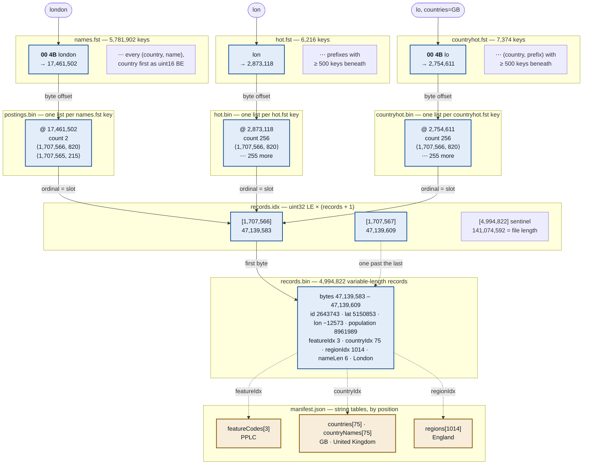
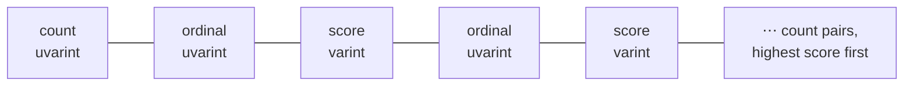

# typetown

[](https://github.com/jasiek/typetown/actions/workflows/ci.yml)
[](https://pkg.go.dev/github.com/jasiek/typetown)

A finite state transducer autocomplete index over the populated places of the
world: a command that builds it, and a Go library that queries it.

Given a prefix of a town's name it returns the locality — town, first-order
division, country — and its coordinates, so the result can be handed to
something that does proximity work.

```
$ typetown query -home US "san fr"
  San Francisco, California, United States          37.7749, -122.4194  pop 827526, PPLA2
```

## Requirements

Go 1.27 (see `.tool-versions` for the exact toolchain).

## Getting the data

```sh
make sources    # ~625 MB from download.geonames.org, fetched once
```

Four inputs are used:

| file | what it provides |
|---|---|
| `allCountries.zip` | every place; 13.5M rows, of which 5.2M are populated places |
| `alternateNamesV2.zip` | names in other languages, **with the flags that make them usable** |
| `admin1CodesASCII.txt` | `GB.ENG` → `England` |
| `countryInfo.txt` | `GB` → `United Kingdom` |

`alternateNamesV2.zip` is worth its size: the equivalent column inside
`allCountries.txt` is a lossy copy with the language codes and the
`isColloquial` / `isHistoric` / `isPreferredName` flags stripped out. Without
them, "New York Van Java" is an alternate name of Jakarta and outranks New York
City for the query `new y`.

## Build

```sh
make index                  # fetch the sources if needed, then build ./index
make build                  # -> bin/typetown
typetown build              # -> ./index, from ./sources
typetown build -countries GB -out index-gb        # a fast subset for development
typetown build -min-population 1000               # smaller index, fewer hamlets
```

### Download one instead

The whole-world index is published as a release asset, so nothing but `curl` is
needed to get one:

```sh
v=$(typetown version -index-format)   # the index format this binary reads
curl -fLO https://github.com/jasiek/typetown/releases/download/index-latest/typetown-index-v$v.zip
unzip typetown-index-v$v.zip          # -> index/
typetown serve -index index
```

A binary reads exactly one index format and refuses any other, so each format is
published under its own name — `typetown-index-v4.zip` — and a new format never
replaces an old one. Replicas still running a release that reads an older format
keep downloading the index they can open, and a rollout can upgrade binaries and
indexes together rather than racing a moving URL. Assets for older formats stay
in the release, frozen at their last build. (The unversioned
`typetown-index.zip` is the last v3 index, from before this naming.)

For a given format the URL never changes: `.github/workflows/index.yml`
regenerates the `index-latest` release in place. It is a release rather than a workflow
artifact because an artifact is only a download for somebody logged in to
GitHub, expires after 90 days, and has no stable address. The release is marked
a pre-release so that it never takes the "Latest release" slot from the `v*`
tags, which are what `go install` follows.

`typetown-index-v4.zip.sha256` and `SOURCES-v4.txt` sit beside the archive, the
second recording the commit, the run and the upstream files the index was built
from, so a download can be traced back to where it came from without unzipping
250 MB.

#### Rebuilding it

Start the workflow from the **Actions** tab → **Index** → **Run workflow**.
Before doing anything else it works out what the index would be built from —
the size of each input, asked of `download.geonames.org`, and a hash of the
packages that turn those inputs into an index — and stops there when the
published `SOURCES-v<format>.txt` already names that pair. Running it again
when nothing has moved therefore costs four HEAD requests. Tick **force** to
rebuild regardless. From a terminal:

```sh
gh workflow run index.yml --ref main              # rebuild if anything moved
gh workflow run index.yml --ref main -f force=true
```

Run it from `main`: the release is shared, so whatever ref the run builds is
what every download of that format gets. Runs queue rather than overlap, and a
queued run that finds its work already published stops at the comparison.

Both halves of that key are deliberate:

- **Size, rather than `Last-Modified` or the `ETag`.** The dumps are
  regenerated nightly whether or not the data moved, so both of those always
  change (Apache builds the `ETag` out of the size and the mtime). Size is the
  only header here that tracks the data, since re-zipping unchanged rows
  produces the same number of bytes. It is not a checksum, so two different
  dumps of identical length would be missed; **force** is the way out of that.
- **The builder, not the commit.** A change to the parser, the ranking or the
  on-disk format does not move the dump sizes, and reusing an index across one
  would be wrong — a `FormatVersion` bump would leave it rejected outright.
  Hashing only the packages that write an index means a README or serve-side
  change costs nothing.

## Query

```sh
typetown query lond                    # one shot
typetown query -home US -limit 5 york  # bias toward a country
typetown query -countries US,CA spring # only places in these countries
typetown query -json edinburgh         # machine-readable
typetown query -i -home US             # interactive
```

### Interactive

`-i` on a terminal searches incrementally: results are redrawn on every
keystroke, `↑`/`↓` move the selection, `enter` accepts it and `esc` quits.
`ctrl-w` deletes a word, `ctrl-u` clears the line.

The redraw goes to stderr and the accepted result to stdout, so the selection
can be captured:

```sh
read -r town lat lon <<<"$(typetown query -i -home US)"
```

When stdin is not a terminal there are no keystrokes to react to, so `-i` falls
back to reading whole lines.

## Use as a library

Build the index with the command, then embed the query side. There is no server
to run and no network hop: opening an index memory-maps it, and a lookup is tens
of microseconds in your own process.

```sh
go get github.com/jasiek/typetown
```

```go
ix, err := typetown.Open("/srv/typetown/index")
if err != nil {
	log.Fatal(err)
}
defer ix.Close()

places, err := ix.Search("krak", typetown.SearchOptions{Limit: 5, Home: "PL"})
// places[0] == {Name: "Kraków", Region: "Lesser Poland", Country: "Poland",
//               CC: "PL", Lat: 50.06143, Lon: 19.93658, ...}
```

`Search` is safe for concurrent use. `Close` is not, and must not race with it.

`Countries` restricts a search to some countries, and changes what it promises:
an unrestricted search ranks a precomputed sample for short prefixes, while a
restricted one considers every match in those countries, so its results are
exactly the best `Limit` of them.

```go
places, err := ix.Search("spr", typetown.SearchOptions{Limit: 20, Countries: []string{"US", "CA"}})
```

### A ready-to-attach endpoint

`Handler` returns an `http.Handler` that answers lookups as JSON. It handles one
route and does not care where you mount it:

```go
http.Handle("/places", typetown.Handler(ix,
	typetown.WithHome("PL"),                    // bias when the request says nothing
	typetown.WithHomeHeader("CF-IPCountry"),    // ...or take it from a trusted proxy
	typetown.WithLimit(5, 20),                  // default and hard maximum
	typetown.WithCORS("https://example.com"),   // omit for backend-only callers
))
```

The caller's position can be passed too, and is worth much more than the country:

```
GET /places?q=springfield&lat=39.80&lon=-89.64
```

`lat` and `lon` must be given together and must be in range, or the request is
400. They combine with the country hint rather than replacing it, so sending
both is safe. Coordinates in a query string end up in access logs and cache
keys, so round them before sending — two decimal places is about a kilometre,
which is all the ranking can use.

```
GET /places?q=lond&limit=3&home=US

{"query":"lond","results":[
  {"id":2643743,"name":"London","region":"England","country":"United Kingdom",
   "cc":"GB","lat":51.50853,"lon":-0.12573,"population":8961989,"kind":"PPLC","score":8.2},
  {"id":4517009,"name":"London","region":"Ohio","country":"United States", ...},
  {"id":4298960,"name":"London","region":"Kentucky","country":"United States", ...}]}
```

`countries` restricts results the same way `Countries` does in the library:

```
GET /places?q=spring&countries=US,CA
```

Anything that is not a comma-separated list of two-letter codes is 400. A
well-formed code the index has no places for is not an error; it matches
nothing.

A missing `q` is 400 and a non-GET method is 405, but a query that matches
nothing is 200 with an empty list — finding no such town is an answer, not an
error. `limit` is clamped to the configured maximum, so one request cannot be
made arbitrarily expensive. Successful responses carry `Cache-Control`, since an
index is immutable once built.

Set `WithHomeHeader` only where a trusted proxy sets the header: otherwise a
client chooses its own bias. The consequence is mild — results come back in a
different order — but it is still input from the network.

## Serve

```sh
typetown serve                                   # http://localhost:8080/places
typetown serve -addr :8080 -home US -cors '*'    # reachable from elsewhere
typetown serve -path /api/v1/places -quiet
```

```
$ typetown serve -index index -home PL
typetown v0.2.0 serving 5165450 places on http://127.0.0.1:8080/places
  try: curl 'http://127.0.0.1:8080/places?q=lond&limit=3'
GET /places?q=krak&limit=2 200 24.967ms
GET /healthz 200 121µs
```

It serves the same handler the library exposes, so the command is a way to try
the endpoint rather than a different implementation of it. `/healthz` reports
what the open index holds. `SIGINT` and `SIGTERM` finish in-flight requests
before exiting, so a container stop does not cut a response in half.

The first request against a freshly opened index takes a few milliseconds and
the rest take well under one: the index is memory-mapped, so the first touch of
each region is a page fault. Under a shared volume the first replica pays that
and the others start against a warm page cache.

## Benchmark

`bench` measures latency, and accuracy too when the query set says what each
query should return. A query set is one case per line:

```
<query>
<query>	<expected geonameid>
<query>	<expected geonameid>	<weight>
```

```sh
typetown bench                                     # built-in sample, latency only
typetown bench -queries set.tsv -home US           # latency and accuracy
typetown bench -queries set.tsv -prefixes 3,4,5    # accuracy as a user types
typetown bench -queries set.tsv -countries US      # restricted to some countries
```

## How it ranks

Every match is scored `prominence − classPenalty`, both fixed at build time so
posting lists can be written pre-sorted and a query is a merge rather than a
scan.

**Prominence** is population, plus the feature code at a quarter weight as a
tiebreak.

Population is recorded for only 9% of populated places, which looks like a
reason not to lead with it — and was, until it was measured. That statistic
describes the *dataset*, not the *queries*: the places people look up are the
ones that have a population figure, and the ones that do not are the tail nobody
searches for. Among the towns in the benchmark, population is present 88% of the
time.

The feature code — GeoNames' own statement of administrative rank — is what
separates places whose population is unrecorded. It is deliberately scaled down:
at full strength a national capital outranked a place with 100,000 more
residents, which measured worse in every country tested.

A third signal was tried and removed: how many writing systems name a place,
which is a better proxy for international notability than a raw count of
alternate names. It lowered accuracy in all 24 countries in the benchmark,
including the ones whose own script is not Latin.

**Class penalty** demotes matches reached through a lesser name — an official
alternate, an ordinary alternate, a historic name. The penalties are bounded on
purpose: a hard tier would bury Mumbai for the query `bombay`, while no penalty
at all lets a large city hijack an unrelated prefix.

Two adjustments happen at query time, because they depend on the caller rather
than the data: an exact-match bonus, and an optional bias toward a home country.
They are applied as a bounded re-rank over a pool of candidates pulled from the
merge.

### Hot prefixes

A short prefix has an enormous number of keys beneath it — `p` covers 333,538 —
which is far too many to walk on every keystroke. Truncating the walk is not an
answer, because the FST yields keys alphabetically: a cap silently ranks by
spelling, and `p` returns Pa Sang, Thailand instead of Paris.

Nearly all of that cost sits in a few thousand prefixes, so the build
precomputes a ranked shortlist for every prefix with at least 500 keys beneath
it — about 6,500 of them, 8 MB — and scans everything else exhaustively, which
is cheap precisely because it is not hot.

### Restricting to countries

Every key in `names.fst` starts with its place's country, so each country's
names sort together into one range. A search restricted to some countries walks
only their ranges, and a prefix that is hot within one country — 7,374 of them,
9 MB — has a per-country shortlist built the same way as the global one.

A per-country shortlist is used only when it provably cannot change the answer.
Everything it left out scored no higher than its last entry, and the caller's
home and position can add at most `HomeBonus + NearBonus` to that. If the
ceiling still reaches the score at the cut-off for the requested limit, a place
left out could have ranked, so that country is walked in full. In practice that
happens with a position and a one- or two-letter prefix: a nearby village can
outrank the shortlist's last entry.

Measured on the full dump, with 100 sampled places per country set (US, PL, GB,
KZ, IS, US+PL and US+CA+GB+IE+AU), every restricted search matched a full walk of
the same countries — 16,520 of 16,520. One-letter prefixes take 34µs at the
median and 331µs at p99. Adding a position raises a one-letter prefix to
1.6ms at the median and 12ms at p99, because of those fallback walks; from three
letters on the median is unchanged and p99 stays near 1ms.

Keying by country is not free for an unrestricted search. A prefix with no
shortlist has to be walked once per country, and the exact-match bonus on a hot
prefix takes one lookup per country. Results are unchanged, but the median goes
from 65µs to 136µs and p99 from 0.50ms to 0.88ms, across a mix of one- to
six-letter prefixes and full names. The index grows by 5%, from 256 MB to 269 MB, and a build takes
66s rather than 49s, because the keys are sorted twice: by name for the global
shortlists, then by country for everything else.

### Memory

Index files are mapped read-only (`PROT_READ`, `MAP_SHARED`) rather than read
onto the heap. Replicas sharing a volume then share one copy of the index in the
host page cache no matter how many run, those pages are reclaimable under memory
pressure instead of triggering an OOM kill, and the Go collector never has to
size a heap around hundreds of megabytes it can never free. A single query
process holds about 7 MB resident against a 266 MB index.

The trade is that a mapping is a live view, not a snapshot: **replace an index by
building into a new directory and swapping, never by overwriting files a reader
may still hold open.** `OpenOptions{NoMmap: true}` reads instead, for callers who
would rather have the snapshot.

## The index on disk

Nine files, in five layers. The diagram follows London through every one of
them, with the numbers the published index actually holds: each box is a file,
the highlighted entry is the one the query lands on, and each arrow is a number
stored in one file that addresses another. Every hop is one of those numbers, so
a query resolves by arithmetic rather than by scanning.

The three paths at the top are alternatives, not stages. `london` walks
`names.fst`; `lon` has too many keys beneath it to walk on a keystroke, so it is
served from `hot.fst`; `lo` restricted to `GB` is hot within that one country, so
it is served from `countryhot.fst`. All three arrive at the same record ordinal.



`00 4B` is the country's index in `manifest.countries` — 75, `GB` — as two
big-endian bytes. A score is stored as a fixed-point integer, the score × 100,
so `820` is London's 8.2. Solid arrows are byte offsets and ordinals into
another file; dashed ones from a record are positions in a manifest table.

Every list in `postings.bin`, `hot.bin` and `countryhot.bin` has the same
encoding and is read by the same decoder:



There is no terminator and no padding, so a list can only be read forwards from
its offset — which is exactly what an FST value hands you. Ordinals are stored
plainly rather than delta-coded: a list is sorted by score, so the deltas would
not be monotonic.

`names.fst` is walked for every query, one country's range at a time: its keys
are the country's index as two big-endian bytes followed by the folded name, so
each country's names sort together. `hot.fst` short-circuits the prefixes with
too many keys beneath them to walk on a keystroke, and `countryhot.fst` does the
same for a prefix within one country; every path converges on record ordinals. Repeated strings — country, region, feature code — live once in
`manifest.json` and are referenced by position, so "United Kingdom" is not
written 250,000 times.

`records.idx` exists because a record is variable-length: eight of its nine
fields are varints, so there is no arithmetic path from an ordinal to a byte
offset. Its extra trailing slot holds the file's length, which lets record `i`
span `[offset[i], offset[i+1])` with no special case for the last one.

## Layout

```
typetown.go         the library: Open, Search, Result
http.go             Handler, and the options that configure it
cmd/typetown/       thin main(): wires stdio into the CLI and exits
internal/cli/       flag parsing, subcommand registry, usage
internal/geonames/  parsing the dumps and folding names
internal/index/     the on-disk format, the builder, and search
internal/testindex/ miniature fixtures, so tests need no downloaded data
```

Only the root package is public. Everything the library does not need to expose
stays under `internal/`, so the on-disk format and the builder can change without
breaking anyone.

## Releasing

Go has no publish step. A release is a git tag, and the module proxy fetches it
from GitHub the first time somebody asks for it.

```sh
make ci                       # the tag should not ship if this is red
git tag -a v0.1.0 -m "v0.1.0"
git push origin v0.1.0
```

That is the whole release for consumers:

```sh
go get github.com/jasiek/typetown@v0.1.0
go install github.com/jasiek/typetown/cmd/typetown@v0.1.0
```

Pushing the tag also triggers `.github/workflows/release.yml`, which runs the
tests, cross-compiles for Linux, macOS and Windows on amd64 and arm64, and
attaches the archives and their checksums to a GitHub Release. Those are a
convenience for people without a Go toolchain; the tag alone is what makes
`go install` work.

Three things about tags are worth knowing before pushing one:

- **A published tag is immutable.** `proxy.golang.org` caches its contents
  permanently. Moving a tag does not change what anyone receives, and leaves
  people whose checksum database disagrees with the new content unable to build.
  Fix a bad release by tagging another one.
- **A mistake is withdrawn with `retract`**, not by deleting the tag: add a
  `retract v0.1.0` line to `go.mod` and tag `v0.1.1`. Existing users see a notice
  rather than a broken build.
- **`v2` and beyond change the import path.** The module path gains a `/v2`
  suffix in `go.mod` and in every import. Until then `v0.x` says the API may
  break between releases, which is honest while it is still settling.

None of that applies to `index-latest`, the tag the index workflow publishes
under. It carries data rather than code, it is not a semver tag so the module
proxy never looks at it, and its release is rewritten in place on purpose.

## Development

```sh
make test   # go test ./...
make lint   # go vet ./...
make tidy   # go mod tidy
make ci     # everything the CI workflow checks, including -race
```

CI runs on Linux and macOS: build, vet, and the tests under the race detector.
The race detector is not decoration here — the index is handed to `net/http` and
searched from every request, so `Search` has to be safe under concurrency, and
the first run of it found a shared `transform.Chain` in the name folder that was
not.
